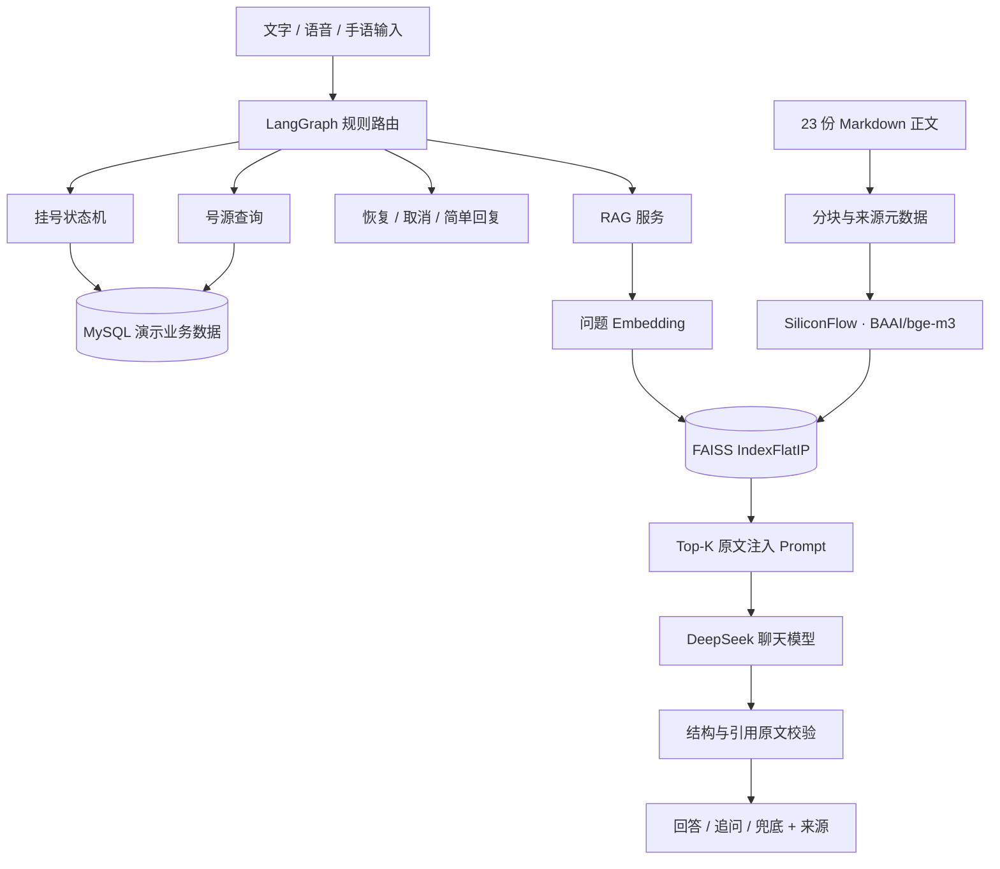

# hospital_sys · 面向听障患者的医院服务 Agent

结合手语输入、文字沟通、医院服务 RAG 与 LangGraph 工作流的就诊辅助项目，覆盖挂号、候诊与面诊沟通。重点探索：在多轮业务中插入知识咨询，提供可核对的证据，并保持原有挂号状态。

本项目用于学习与演示。知识库未经医院审核，不代表真实医院服务承诺；系统不提供诊断、处方或个体化检查准备方案。

## 功能

| 模块 | 当前实现 |
| --- | --- |
| 医院服务 RAG | Markdown → 分块 → Embedding API → FAISS Top-K → Prompt → 带引用回答 |
| 知识咨询前端 | 独立咨询页、挂号页入口、引用展开、加载提示、取消等待及失败重试 |
| LangGraph 编排 | 规则路由至挂号、知识咨询、号源查询、恢复流程、取消和简单回复 |
| 挂号业务 | 症状理解、槽位合并、追问、号源匹配及确认提交 |
| 会话管理 | 咨询不覆盖挂号槽位，支持恢复最近挂号步骤和咨询追问上下文 |
| 手语辅助 | MediaPipe 关键点、多流识别模型、候选词确认及连续词序列输入 |
| 面诊辅助 | 表达润色、症状摘要及分层患者记忆，不代替医生判断 |
| 异常处理 | 有限重试、检索/生成失败兜底、引用校验及节点耗时记录 |

RAG 已做真实 API 验证，咨询页面已可使用。LangGraph 编排行为通过模拟业务回调测试；完整数据库挂号仍需在部署环境联调。

## 架构



LangGraph 负责显式分支，LangChain 继续负责已有模型调用。首版复用完整挂号状态机作为业务节点，没有将其内部每一步拆成图节点。

知识库包含 10 份科室介绍、4 份挂号流程、4 份检查事项、4 份无障碍服务和 1 份服务边界。仅导入 manifest 指定正文，不将 README 或评测题向量化。

## 快速开始：独立 RAG 演示

无需 MySQL、手语模型和患者登录。以下命令使用 Windows PowerShell，支持 Python 3.9–3.12，推荐 Python 3.11。请在项目根目录执行。

### 1. 安装

```powershell
python -m venv .rag-venv
.\.rag-venv\Scripts\python.exe -m pip install -r requirements-rag.txt
```

### 2. 配置

参考 [.env.rag.example](.env.rag.example)，新建项目根目录 `.env.local`。若文件已存在，追加配置，不要覆盖原配置。

```dotenv
RAG_EMBEDDING_BASE_URL=https://api.siliconflow.cn/v1
RAG_EMBEDDING_MODEL=BAAI/bge-m3
RAG_EMBEDDING_API_KEY=替换为硅基流动Key
RAG_CHAT_BASE_URL=https://api.deepseek.com
RAG_CHAT_MODEL=deepseek-chat
RAG_CHAT_API_KEY=替换为DeepSeekKey
```

Embedding 与聊天服务独立配置。建库会将演示知识发送给 Embedding API；问答会将问题与检索证据发送给对应模型服务，可能产生服务商费用。真实 Key 不应提交到仓库。

聊天配置可复用 OPENAI_API_KEY、OPENAI_BASE_URL、LC_MODEL：系统环境变量与 `.env.local` 优先，之后读取原项目 `backend/.env` 中的这三个字段。

### 3. 分块与建库

```powershell
.\.rag-venv\Scripts\python.exe -m tools.build_knowledge_chunks
.\.rag-venv\Scripts\python.exe -m tools.build_knowledge_index
```

默认约 500 字分块、80 字重叠，优先保留段落和句子。当前正文都不足 500 字，默认导出 23 个完整片段；当前模型实际返回 1024 维向量。

`data/rag/` 是可重建产物，已忽略版本控制，新克隆项目需自行建库。片段、模型或 API 地址改变后应重建索引；全量发布新索引版本，避免重复追加旧片段。

### 4. 启动

终端一：

```powershell
.\.rag-venv\Scripts\python.exe -m uvicorn backend.rag_app:app --host 127.0.0.1 --port 8000
```

终端二：

```powershell
python -m http.server 8001 --bind 127.0.0.1 --directory frontend
```

- [咨询页面](http://127.0.0.1:8001/knowledge.html)
- [接口文档](http://127.0.0.1:8000/docs)

接口 `POST /api/knowledge/chat` 的 JSON 请求：

```json
{"question":"手语识别错了怎么办？","top_k":3}
```

响应包含 answer、status、sources、retrieved_sources、scope_notice 和 timings_ms。sources 是实际引用证据，retrieved_sources 是检索候选，不能全部当作回答引用。

命令行也可直接检索或问答：

```powershell
.\.rag-venv\Scripts\python.exe -m tools.search_knowledge "手语识别错了怎么办？" --top-k 3
.\.rag-venv\Scripts\python.exe -m tools.ask_knowledge "手语识别错了怎么办？" --output data/rag/answer_demo.json
```

## 完整系统：挂号与 LangGraph

完整系统需要 MySQL、模型文件及原业务依赖。推荐另用 Python 3.10/3.11 环境：固定的 torch 2.0.1 与 numpy 1.24.3 不适合 Python 3.12。不要直接合并安装 requirements.txt 与 requirements-rag.txt，它们的 NumPy 固定版本不同。

```powershell
python -m pip install -r requirements.txt
python -m pip install faiss-cpu==1.8.0.post1
```

requirements.txt 已包含 LangGraph 0.2.60 和兼容的 langchain-core 0.3.23。原环境增量安装使用 `python -m pip install -r requirements-workflow.txt`。上述 FAISS 版本支持 NumPy 1.x，无需照搬独立 RAG 的 NumPy 1.26.4 固定值。

在 MySQL 客户端初始化 `medical_agent_db`：

```sql
SOURCE D:/你的项目路径/hospital_sys/db/init.sql;
```

该脚本会删除并重建同名业务表，只应在专用演示数据库执行。确认 backend/database.py 的连接地址与本机数据库一致。

手语模块需要：

```text
robust_multistream_checkpoints/best_robust_multistream_newdata73.pth
robust_multistream_checkpoints/sign_label_mapping_73.json
```

权重是否放入仓库或通过外部下载提供需另行安排，本 README 不提供未经验证的下载地址。前端 Vue、Tailwind 和 MediaPipe 使用 CDN，需要网络访问。

```powershell
python -m uvicorn backend.main:app --host 127.0.0.1 --port 8000
```

使用同一前端静态服务，打开 [场景入口](http://127.0.0.1:8001/index.html) 或 [挂号页](http://127.0.0.1:8001/reg.html)。完整后端与独立 RAG 后端不要同时占用 8000 端口。

核心演示：

> 我想挂明天上午耳鼻喉科 → 听不清叫号怎么办？ → 继续挂号 → 核对信息 → 确认

`POST /api/agent/register/chat` 由 LangGraph 编排。咨询期间直接说“确认”不会提交，需先恢复挂号。独立咨询页面不维护挂号会话。

## 测试与实验记录

```powershell
python -m unittest evaluation.test_rag_documents evaluation.test_rag_index evaluation.test_rag_answers evaluation.test_hospital_workflow -v
```

上述 19 项测试已在开发环境通过，图测试需安装 requirements-workflow.txt。API 测试另需 httpx==0.27.2，执行 `python -m unittest evaluation.test_rag_api -v`。

现有验收集包含 16 个问题，其中 9 个是可回答知识题，其余为追问、未知信息和业务查询。真实 API 的一次 Top-K=3 开发验收结果：

| 指标 | 结果 |
| --- | --- |
| 知识题至少命中一份预期文档 | 9/9 |
| 知识题平均文档级 Recall@3 | 94.4% |
| 全部 16 题平均检索耗时 | 约 170 ms |

这不是独立测试集成绩，也不是回答正确率。一个包含两份预期证据的问题只召回其中一份，故平均 Recall@3 低于命中率。网络与服务负载会影响延迟。

```powershell
python -m tools.check_knowledge_retrieval --top-k 3
```

逐题结果保存在 data/rag/retrieval_smoke_top3.json。真实问答已验证带引用回答、检查信息追问、未知费用兜底和实时号源边界；尚未完成 30–50 题独立回答评测或 Top-K/Reranker 对照实验。

## 当前限制与后续工作

- 引用校验检查来源编号及原文连续片段，不自动证明语义支持关系，仍需人工评测。
- 余弦相似度不是可信概率，尚未校准拒答阈值。
- 会话、锁和请求去重保存在单进程内存中，重启丢失；未接入持久化 checkpointer 或跨 worker 幂等保证。
- SUCCESS 状态阻止同会话重复提交；生产级幂等仍需要数据库唯一约束与事务方案。
- 号源查询复用演示 crud.get_slots，可能自动创建科室或排班，不是真实医院纯只读接口。
- 取消对话不撤销已创建挂号，排队进度工具尚未接入。
- 规则路由覆盖有限，尚未完成完整意图评测、流式输出和生产认证授权。

后续重点：独立评测及对照实验、数据库级幂等、会话持久化、检索改进与完整应用联调。

## 项目结构

```text
hospital_sys/
├── backend/
│   ├── main.py                       # 完整医院应用
│   ├── rag_app.py                    # 独立 RAG API
│   ├── routers/agent.py               # 挂号编排与既有业务逻辑
│   ├── routers/knowledge.py           # 知识接口
│   ├── services/hospital_workflow.py  # LangGraph 路由
│   └── services/rag/                  # 文档、Embedding、索引、引用回答
├── frontend/                         # 挂号、医生端、手语与咨询页面
├── knowledge/hospital/               # 23 份正文与 manifest
├── tools/                            # 分块、建库、检索、问答与验收
├── evaluation/                       # 测试与评测数据
├── db/init.sql                       # 演示数据库
├── robust_multistream_checkpoints/   # 手语模型与标签
├── requirements.txt                  # 完整系统依赖
├── requirements-rag.txt              # 独立 RAG 依赖
└── requirements-workflow.txt         # LangGraph 增量依赖
```

- [知识库说明](knowledge/hospital/README.md)
- [文档加载与分块](knowledge/hospital/CHUNKING.md)
- [Embedding 与检索](knowledge/hospital/RETRIEVAL.md)
- [引用回答与前端](knowledge/hospital/ANSWERS.md)
- [LangGraph 流程](knowledge/hospital/WORKFLOW.md)

## 常见问题

| 现象 | 检查方法 |
| --- | --- |
| No module named uvicorn/faiss | 使用 python -m pip 将依赖安装到当前 Python 环境 |
| 8000 根路径返回 404 | 正常；后端文档在 /docs，前端在 8001 |
| 前端超时 | 确认静态服务运行，以 curl.exe --max-time 5 -I http://127.0.0.1:8001/knowledge.html 检查 |
| 咨询 HTTP 503 | 检查配置、依赖及索引是否生成 |
| retrieval_unavailable / generation_unavailable | 检查对应 API 的网络、Key、模型与额度 |
| 索引模型或片段不匹配 | 重新运行 build_knowledge_index |
| 完整挂号接口不存在 | 启动 backend.main，独立 backend.rag_app 不包含挂号业务 |

## 发布到 GitHub 前

当前仍需清理发布配置：backend/.env 已被 Git 跟踪，backend/config.py 存在 API 密钥默认值，backend/database.py 的连接地址需要脱敏。应移除真实配置、必要时更换密钥并检查 Git 历史；仅添加 .gitignore 不会移除已跟踪文件或历史记录。

仅保留示例配置与匿名演示数据，检查患者信息、模型文件和临时产物后再公开。当前未提供开源许可证，发布者需确认代码、数据与模型授权后选择许可证。
