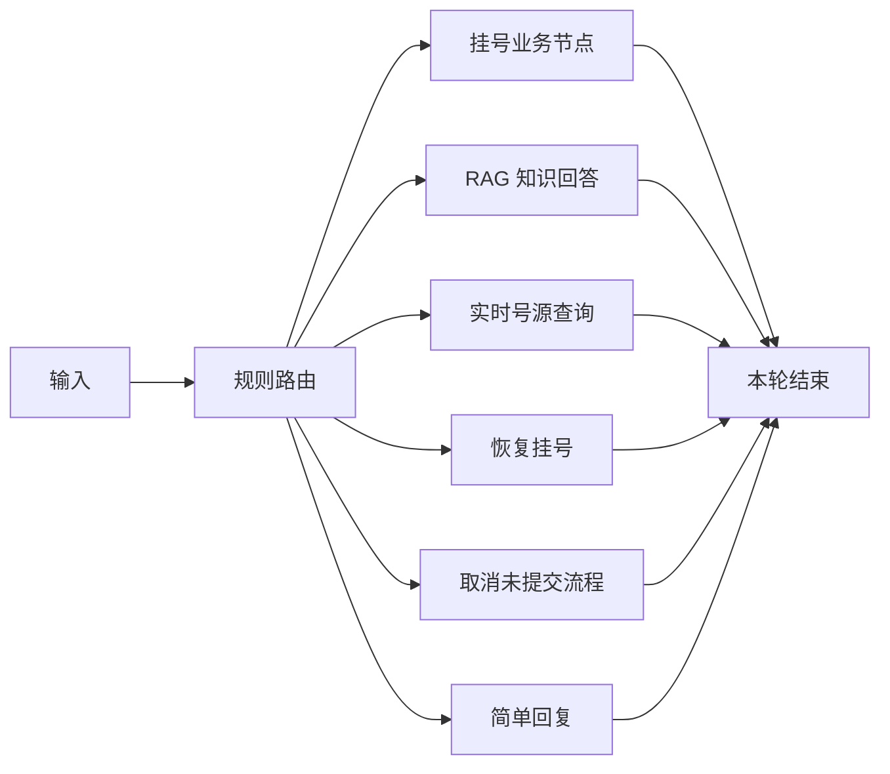

# LangGraph 医院挂号与知识咨询编排

## 安装与运行

在原医院后端环境安装 `python -m pip install -r requirements-workflow.txt`。固定 LangGraph 0.2.60 与 langchain-core 0.3.23（LangGraph 排除了旧 0.3.18），保持现有 LangChain 0.3 系列兼容，不升级为 1.x。原后端还需要 requirements.txt、RAG 依赖和 MySQL；NumPy 的旧版固定值与 requirements-rag.txt 不同，应在实际运行环境统一版本，不能把两个文件盲目混装。

运行完整医院应用 `python -m uvicorn backend.main:app --port 8000`；挂号页面调用原来的 `POST /api/agent/register/chat`，该端点现在通过 LangGraph 编排。独立 backend.rag_app 仍只提供知识问答，不能代替完整挂号后端。

请求继续使用 session_id、patient_id、message，可选 request_id 用于同会话最近 20 次请求的重放去重。重复 request_id 必须使用相同 message，否则返回 409。session_id 与 patient_id 不匹配返回 400；患者校验沿用现有系统，患者 ID 不等于新增身份认证。

## 图结构



使用实际 StateGraph、条件边和节点执行。首版挂号业务节点仍复用既有症状理解、槽位合并、追问、号源匹配及提交状态机，不宣称已把其中每一步拆为独立图节点。回复包含 workflow_route 与 workflow_trace，记录各节点毫秒耗时。

## 会话与提交规则

- 咨询及号源查询不改挂号槽位；RAG 追问只保存在 workflow.pending_question。
- “继续挂号”恢复最近挂号回复，不自动提交。咨询状态下单独说“确认”提示先恢复流程。
- 提交仅接受明确的“确认”“确认挂号”“确定挂号”及兼容英文确认词，不接受模型推断或含有“确认”的任意句子。
- CONFIRM 阶段修改信息会清掉旧 schedule_id 并重新进入收集/匹配，之后再次确认。
- SUCCESS 后不能重复提交；SUBMIT 结果不明时提示核实，不自动重试写库。
- “取消挂号”只清空尚未提交的会话，不执行已创建挂号的撤销或退款。
- 同会话加锁，避免同一进程并发确认。request_id 重放和 SUCCESS 防重均为进程内能力；重启、多 worker、不同 session 的业务幂等尚需数据库唯一键与事务级方案。

沿用 helpers.agent_sessions 内存存储，未使用持久化 checkpointer。重启会丢失会话；当前请使用单 worker。会话和锁未设置 TTL，不适合长期生产部署。后续可迁移 Redis/数据库及图 checkpoint，避免同时维护两套互相矛盾的状态。

规则路由可预测但覆盖有限：目前不是 LLM 意图分类器。实时号源查询复用 crud.get_slots，该函数在演示数据库中可能自动创建科室或排班；这并非真实医院只读查询，部署时需替换真实号源接口。尚未接入排队进度查询。

## 验收

```powershell
python -m unittest evaluation.test_hospital_workflow -v
```

核心多轮：我想挂明天上午耳鼻喉科 → 听不清叫号怎么办 → 确认（不得提交）→ 继续挂号 → 确认 → 确认（不得重复创建）。同时检查 RAG 追问补充、取消、修改时段、实时号源和模型失败后恢复。

测试使用真实 LangGraph 和模拟业务回调，验证编排行为；真实挂号数据库与手语模型需要在完整应用环境中联调，不应把模拟提交算作真实挂号成功。
